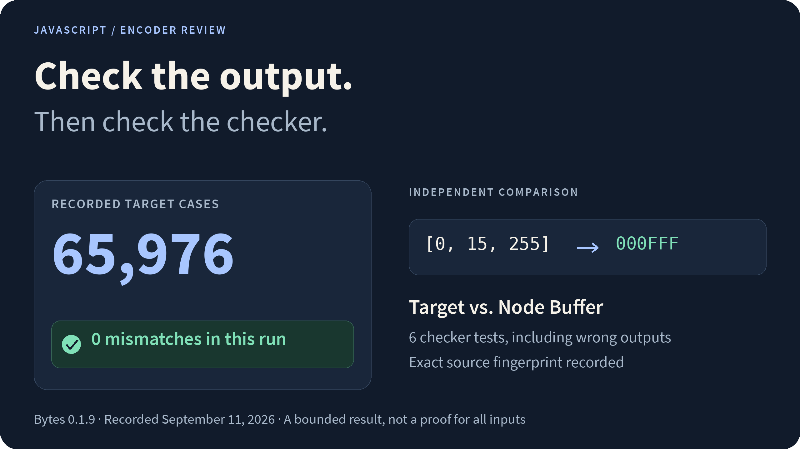

# Encoder Review

A reproducible functional check of one published byte-to-hex encoder, using an independent reference and tests for the checker itself.

<picture>
  <source media="(max-width: 600px)" srcset="docs/assets/overview-mobile.png">
  
</picture>

**[Read the recorded result](results/2026-09-11.json)** · **[Repeat the review](docs/reproduce.md)** · [Method and limits](docs/method.md)

Node.js 24+ · No npm dependencies · MIT-licensed harness

## What was checked

The target is `BytesToTextBase16` from Progsbase's **Bytes 0.1.9** JavaScript bundle. Its exact download address and SHA-256 fingerprint are in [source-record.json](source-record.json). The third-party bundle is downloaded separately.

**The September 11, 2026 run checked 65,976 cases and found zero mismatches.** The expected values came from Node's `Buffer` hex encoding, computed from a separate input copy before the target ran.

| Input group | Cases |
| --- | ---: |
| Every two-byte combination | 65,536 |
| Every single byte | 256 |
| Seeded longer arrays | 160 |
| Repeated zero or maximum byte | 20 |
| Empty input and negative zero | 2 |
| Full byte range, ascending and descending | 2 |

Longer inputs are sampled. This is a bounded result for one exact source file.

## Start with the checker tests

```sh
git clone https://github.com/jackspiece/encoder-review-example.git
cd encoder-review-example
node --test test/*.test.cjs
```

The six original tests are preserved. Additional tests reject 12 deliberately incorrect encoder controls, check 512 generated valid encodings, run all 65,976 generated cases against a local reference encoder and faulty variants to check the case groups and compact failure reports, and verify worker time/output limits, source-pin rejection, report overwrite protection and parent-signal cleanup. CI runs only these local checker tests, without downloading the external bundle.

**To run all 65,976 target cases**, follow the [reproduction steps](docs/reproduce.md) to download the pinned bundle and run `verify.cjs`.

## Find your way through the code

| File | Purpose |
| --- | --- |
| [verify.cjs](verify.cjs) | Command-line entry point: runs the review worker under time and output limits, cancels it on SIGINT/SIGTERM and publishes the report without overwriting. |
| [review-worker.cjs](review-worker.cjs) | Checks the SHA-256 pin, loads the bundle, runs the published smoke test and the 65,976 cases, and writes the staged report. |
| [review-cases.cjs](review-cases.cjs) | Generates the 65,976 deterministic cases, counts them by group and keeps short records of failing cases. |
| [bounded-process.cjs](bounded-process.cjs) | Runs the worker with a 120-second wall-time limit, a 128 MiB V8 old-space limit and a 1 MiB output cap. |
| [validator.cjs](validator.cjs) | Compares one encoder call with an independent expected result. |
| [source-record.json](source-record.json) | Download address, SHA-256 and size of the pinned third-party bundle. |
| [test/](test/) | 35 checker tests: 6 core checks, 12 faulty-encoder controls, 1 test of 512 generated valid encodings, 3 case-generation tests, 9 process-limit and CLI tests, 4 POSIX-only signal tests. |
| [results/2026-09-11.json](results/2026-09-11.json) | The dated run, counts, seed, fingerprints and limitations, produced by the harness at commit [faacbef](https://github.com/jackspiece/encoder-review-example/commit/faacbefd9711bcb5cd1285640905eeda6776940e). |

The [method notes](docs/method.md) explain what the controls establish and where coverage ends. No reward claim was submitted from this check.

---

Harness and review by [jackspiece](https://github.com/jackspiece). [MIT License](LICENSE) for the original code in this repository.
